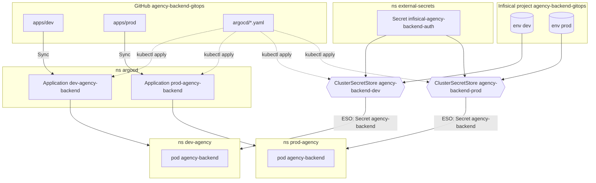

# agency-backend-gitops

Deployment (CD) of [agency-backend](https://github.com/Everesto-Inc/agency-backend), DevOps space **orchid**, managed by Backstage.
Backstage writes git and Infisical only; ArgoCD creates everything in the cluster from git (app-of-apps), so normally
nothing has to be run by hand. The commands below are for checking and for emergencies, on the control plane
(`ssho control-plane`). Every command is safe to run again.

## What runs where



| Object | Kind | Namespace | Created by |
|---|---|---|---|
| `infisical-agency-backend-auth` | Secret (Infisical login) | external-secrets | you — step 2 |
| `infisical-agency-backend-dev` / `-prod` | ClusterSecretStore | — (cluster-wide) | you — steps 3 / 7 |
| `orchid` | AppProject | argocd | you — step 4 |
| `dev-agency-backend` / `prod-agency-backend` | Application | argocd | you — steps 4 / 7 |
| `dev-agency` / `prod-agency` | Namespace | — | ArgoCD on Sync |
| `agency-backend` | Deployment, Service, ExternalSecret | dev-agency / prod-agency | ArgoCD on Sync |
| `agency-backend` | Secret (the app's secrets) | dev-agency / prod-agency | ESO, from Infisical |

Why the files have no `namespace:` line: it is set once per folder in `apps/<env>/kustomization.yaml`
(`namespace: dev-agency` / `prod-agency`) and in each Application's `destination`.

## Once (per cluster / per app)

### 1. Tenant node label (once per cluster)

```bash
sudo kubectl label node dev-k3s-argocd everesto.live/pool=tenants --overwrite
```

Every tenant Deployment has nodeSelector everesto.live/pool=tenants. Without this label the pods stay Pending. Already done if any other app runs.

**Creates:**

- label everesto.live/pool=tenants (node dev-k3s-argocd)

### 2. Infisical login for ESO (identity eso-agency-backend)

```bash
# AUTOMATIC — Backstage stores the login in Infisical (platform-eso); ESO creates Secret infisical-agency-backend-auth.
# Rotate: Secrets tab → "New ESO login". Check:
sudo kubectl -n external-secrets get externalsecret infisical-agency-backend-auth
```

The login ESO uses to READ the Infisical project agency-backend-gitops (dev and prod). Real values are never stored: Backstage → agency-backend-gitops → Secrets → "New ESO login" shows this command with them, once. Lives in external-secrets, which tenants cannot read.

**Creates:**

- Secret infisical-agency-backend-auth (ns external-secrets)

## Dev

### 3. Secret store for dev

```bash
# AUTOMATIC — committed to gitops-backstage/platform/tenants/orchid/agency-backend.yaml, created by ArgoCD (root app platform-tenants).
sudo kubectl get clustersecretstore infisical-agency-backend-dev
```

Tells ESO where dev secrets come from: Infisical project agency-backend-gitops, environment dev, path /, using the login of step 2. Its condition allows ONLY namespace dev-agency to use it.

**Creates:**

- ClusterSecretStore infisical-agency-backend-dev (cluster-wide)

### 4. ArgoCD project orchid + application dev-agency-backend

```bash
# AUTOMATIC — same tenant file; the app appears in ArgoCD ~3 min after Create deployment.
sudo kubectl -n argocd get application dev-agency-backend
```

AppProject orchid = guard rails: only *-gitops repos, only namespaces dev-agency / prod-agency. Application dev-agency-backend = an instruction to ArgoCD: "take folder apps/dev of agency-backend-gitops and put it into dev-agency, sync manually". It creates no pods yet — it appears as a tile in ArgoCD.

**Creates:**

- AppProject orchid (ns argocd)
- Application dev-agency-backend (ns argocd)

### 5. Sync dev-agency-backend (or ArgoCD UI → Sync)

```bash
sudo kubectl -n argocd patch application dev-agency-backend --type merge -p '{"operation":{"sync":{}}}'
```

ArgoCD applies everything in apps/dev: the namespace first, then Deployment (image + tag, port, /health probes, memory), Service (port 80 → container port) and ExternalSecret. ESO sees the ExternalSecret and creates Secret agency-backend from Infisical dev; the pod gets every key as an environment variable. Run again after every "Deploy to dev".

**Creates:**

- Deployment + pod agency-backend (ns dev-agency)
- Service agency-backend (ns dev-agency)
- ExternalSecret agency-backend (ns dev-agency)
- Secret agency-backend (ns dev-agency, created by ESO)
- RoleBinding backstage-read-agency-backend (ns dev-agency: Backstage may READ this namespace — CD tab)

### 6. Check dev

```bash
sudo kubectl -n argocd get application dev-agency-backend
sudo kubectl -n dev-agency get pods,externalsecret,secret
```

Application Synced/Healthy, pod Running, ExternalSecret SecretSynced, Secret present.

## Prod

### 7. Prod secret store + application prod-agency-backend — only after the first "Promote to prod" PR is merged (not done yet)

```bash
# AUTOMATIC on the first Promote — the prod store + app join the tenant file.
sudo kubectl -n argocd get application prod-agency-backend
```

Same as steps 3 + 4 for prod: the store reads Infisical environment prod and only namespace prod-agency may use it; the Application takes apps/prod into prod-agency. The file exists only after the first promote PR is merged (404 before). Set the real prod secrets in the Secrets tab before syncing.

**Creates:**

- ClusterSecretStore infisical-agency-backend-prod (cluster-wide)
- Application prod-agency-backend (ns argocd)

### 8. Sync prod-agency-backend (or ArgoCD UI → Sync)

```bash
sudo kubectl -n argocd patch application prod-agency-backend --type merge -p '{"operation":{"sync":{}}}'
```

Like step 5, for prod. Run again after every merged "Promote to prod" PR.

**Creates:**

- Deployment + pod agency-backend (ns prod-agency)
- Service agency-backend (ns prod-agency)
- ExternalSecret agency-backend (ns prod-agency)
- Secret agency-backend (ns prod-agency, created by ESO)
- RoleBinding backstage-read-agency-backend (ns prod-agency: Backstage may READ this namespace — CD tab)

### 9. Check prod

```bash
sudo kubectl -n argocd get application prod-agency-backend
sudo kubectl -n prod-agency get pods,externalsecret,secret
```

Application Synced/Healthy, pod Running, ExternalSecret SecretSynced, Secret present.

## Day to day

| I want to… | Do |
|---|---|
| deploy a new build to dev | Backstage → CD card → **Deploy to dev** → pick a build → step 5 (Sync) |
| put dev's version into prod | Backstage → **Promote to prod** → merge the PR → step 8 (Sync) |
| roll back | **Deploy to dev** with an older build (the last 5 images are kept) → Sync; then promote |
| change a secret | Backstage → agency-backend-gitops → **Secrets** → dev/prod (prod: maintainers/owners) → then: |

```bash
# apply a changed secret now (dev; use prod-agency for prod) — only when the app already runs there
sudo kubectl -n dev-agency annotate externalsecret agency-backend force-sync=$(date +%s) --overwrite
sudo kubectl -n dev-agency rollout restart deployment agency-backend
```

## Troubleshooting

| Symptom | Cause | Fix |
|---|---|---|
| `namespaces "prod-agency" not found` | prod not synced yet | steps 7 + 8 |
| `argocd-prod.yaml` → 404 | first promote PR not merged yet (or GitHub cache, ~5 min) | merge the PR, wait |
| pod `Pending` | node label missing | step 1 |
| ExternalSecret `SecretSyncedError` | login secret missing/wrong, or store missing | step 2 ("New ESO login"), steps 3 / 7 |
| pod `ImagePullBackOff` | image package is private | GitHub → Packages → agency-backend → make public |
| pod `CrashLoopBackOff` | app fails at start — often a `CHANGE_ME` secret | Secrets tab → set the value → apply |
| Application `OutOfSync` | expected: sync is manual | Sync (steps 5 / 8) |

